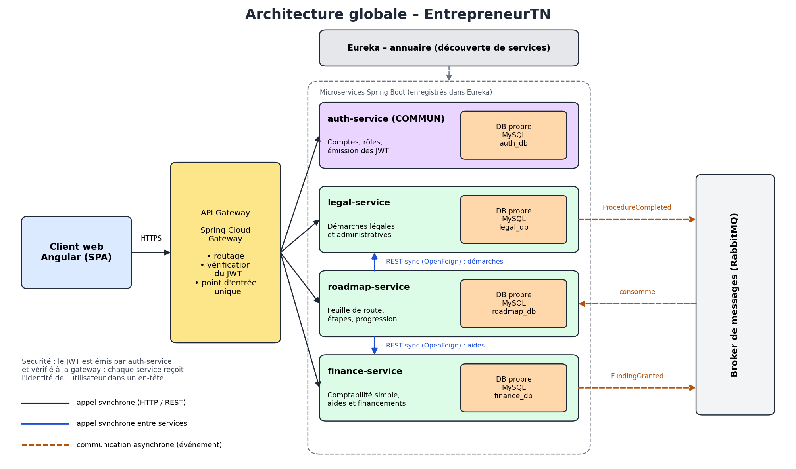

# EntrepreneurTN

Plateforme web qui accompagne les **entrepreneurs et petites agences tunisiennes** dans le lancement et la gestion de leur activité : feuille de route, démarches légales et administratives, comptabilité et financement.

> Projet de l'unité **Architecture web distribuée** (ESPRIT, 4SSA10) – validation intermédiaire (semaine 4) : **conception**. Le code est en cours de développement.

## Équipe
| Membre | Microservice |
|---|---|
| [Membre 1] | roadmap-service (+ présente le microservice commun) |
| [Membre 2] | legal-service |
| [Membre 3] | finance-service |

Microservice commun, développé par toute l'équipe : **auth-service**.

## Architecture


| Composant | Rôle | Port | Base |
|---|---|---|---|
| api-gateway | entrée unique, vérification du JWT | 8080 | - |
| eureka-server | annuaire des services | 8761 | - |
| auth-service (commun) | comptes, rôles, JWT | 8081 | MySQL `auth_db` |
| roadmap-service | projets, feuille de route, progression | 8082 | MySQL `roadmap_db` |
| legal-service | démarches légales et administratives | 8083 | MySQL `legal_db` |
| finance-service | comptabilité, aides et financements | 8084 | MySQL `finance_db` |

Communication : **REST synchrone** (OpenFeign) de roadmap vers legal et finance ; **événements asynchrones** (RabbitMQ) `ProcedureCompleted` et `FundingGranted` vers roadmap.

## Technologies
Angular · Spring Boot 3.5 (Java 17) · Spring Cloud Gateway · Eureka · OpenFeign · Spring Security (JWT) · MySQL (phpMyAdmin) · RabbitMQ · Swagger / OpenAPI · Git.

## Structure du dépôt
```
Backend/        auth-service, roadmap-service, legal-service, finance-service, api-gateway, eureka-server
Frontend/       application Angular
Documentation/  dossier technique, présentation, diagrammes
```
Chaque service contient son contrat d'API : `Backend/<service>/openapi.yaml`.

## Organisation
- Branches : `main` (stable), `develop`, `feature/<service>-<sujet>` ; fusion par Pull Request relue par un autre membre.
- Gestion du projet : GitHub Projects (tableau des tâches par service).

## Lancer le projet
À compléter au fil du développement (ordre : bases, Eureka, services, gateway, frontend).
