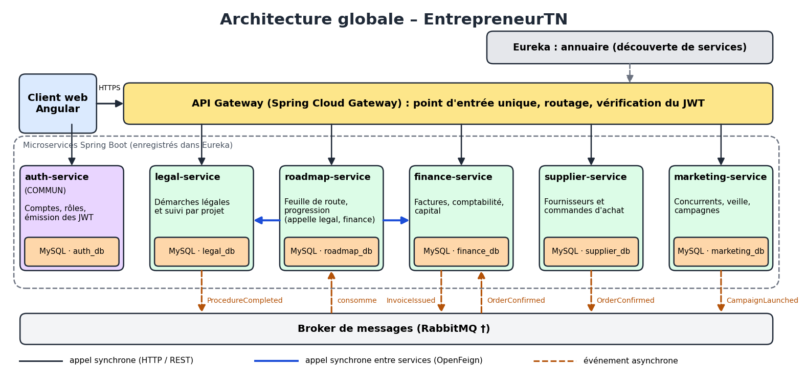

# EntrepreneurTN

Plateforme web qui accompagne les **entrepreneurs et petites agences tunisiennes** dans le lancement et la gestion de leur activité : feuille de route, démarches légales et administratives, facturation et comptabilité, marketing et veille concurrentielle, fournisseurs.

> Projet de l'unité **Architecture web distribuée** (ESPRIT, 4SSA10) . Le code est en cours de développement.

## Équipe
| Membre | Microservice |
|---|---|
| Badis Beji | roadmap-service |
| Yakine Sehli| legal-service |
| Mohammed Saadallah | finance-service |
| Ilyes Anene | marketing-service |
| Khaled Khalil | supplier-service |

Microservice commun, développé par toute l'équipe : **auth-service**.

## Architecture


| Composant | Rôle | Port | Base |
|---|---|---|---|
| api-gateway | entrée unique, vérification du JWT | 8080 | - |
| eureka-server | annuaire des services | 8761 | - |
| auth-service (commun) | comptes, rôles, JWT | 8081 | MySQL `auth_db` |
| roadmap-service | projets, feuille de route, progression | 8082 | MySQL `roadmap_db` |
| legal-service | démarches légales et administratives | 8083 | MySQL `legal_db` |
| finance-service | facturation, comptabilité et gestion du capital | 8084 | MySQL `finance_db` |
| marketing-service | veille concurrentielle et campagnes marketing | 8085 | MySQL `marketing_db` |
| supplier-service | fournisseurs et commandes d'achat | 8086 | MySQL `supplier_db` |

Communication : **REST synchrone** (OpenFeign) de roadmap vers legal et finance ; **événements asynchrones** (RabbitMQ) : `ProcedureCompleted`, `InvoiceIssued` et `CampaignLaunched` vers roadmap, `OrderConfirmed` de supplier vers finance.

## Technologies
Angular · Spring Boot 3.5 (Java 17) · Spring Cloud Gateway · Eureka · OpenFeign · Spring Security (JWT) · MySQL (phpMyAdmin) · RabbitMQ · Swagger / OpenAPI · Git.

## Structure du dépôt
```
Backend/        auth-service, roadmap-service, legal-service, finance-service, marketing-service,
                supplier-service, api-gateway, eureka-server
Frontend/       application Angular
Documentation/  dossier technique, présentation, diagrammes
```
Chaque service contient son contrat d'API : `Backend/<service>/openapi.yaml`.

## Organisation
- Branches : `main` (stable), `develop`, `feature/<service>-<sujet>` ; fusion par Pull Request relue par un autre membre.
- Gestion du projet : GitHub Projects (tableau des tâches par service).

## Lancer le projet
À compléter au fil du développement (ordre : bases, Eureka, services, gateway, frontend).
